>**20 November 2026**  
>**Journal 1**  
>**~1 hr 35 mins**   
>I laid out the PCB schematic in KiCad using some YouTube videos and finding the exact components in the library. Not really difficult, but there were some errors with the XIAO RP2040 library footprint. Later, after adding the required footprints, I attached them to the schematics. Finally, routed the components in sch.
>
>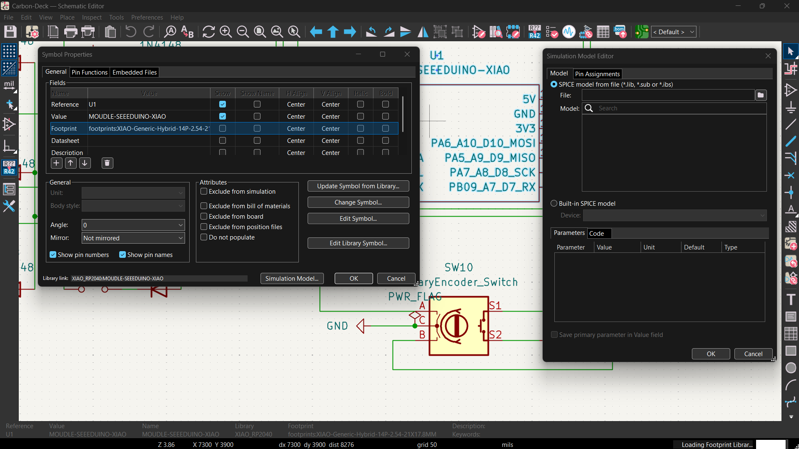
>
>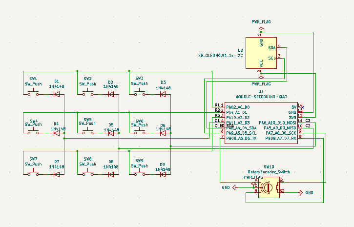

>**20 November 2026**  
>**Journal 2**  
>**~3 hrs 15 mins**   
>Now in the PCB editor, I made a board outline with some estimated dimensions and placed the components as I decided (which took an eternity). Ultimately, I decided that the keypad will be right-hand use but will have WASD controls for the left hand. Out of 9 keys, 9 keys line up as a 4x2 grid (which uses Cherry MX Red switches), and one switch sits standing out (decided to have a function of Ctrl). Once done, I routed the components. Everything routed on the front.cu layer except some diode-key connections. Very clean routing. And after routing once I wanted it to be a bit compact so replaced most of the components (Diode, switches, encoder and display) and completed the routing. Once done, I finalized the board outline dimensions. Ultimately, it's a 3x3 matrix. + Some huge amount of PCB mechanics :(
>
>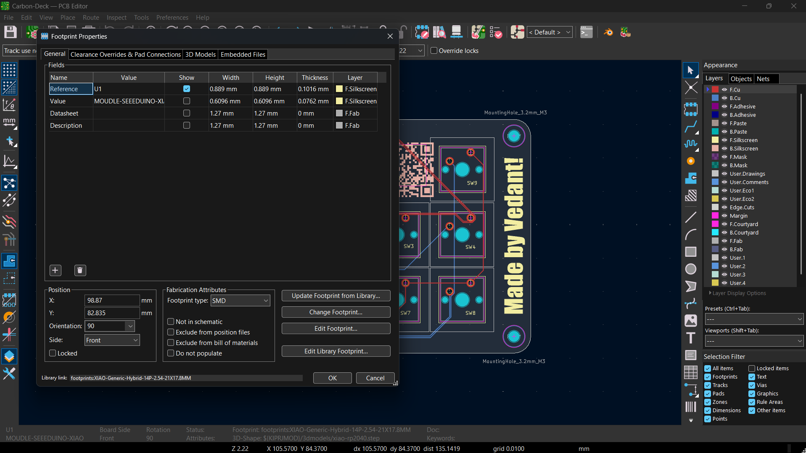
>
>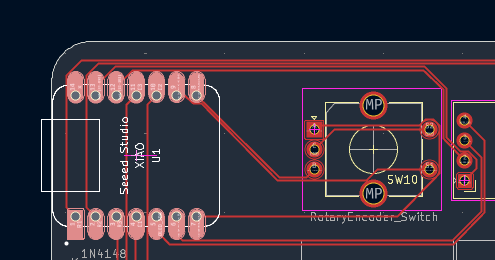
>

>**20 November 2026**  
>**Journal 3**  
>**~1 hrs 25 mins**
>- Made some QR codes on the PCB front and back silkscreen using KiCAD's integrated feature: Place Barcode. These QRs embed some songs in them.
>- Was trying to do some artwork on the front and back silkscreen, but it was not so clean, so I dropped the idea.
>- Added a text using ctrl+shift+t on the front silkscreen.
>- The generated QRs were not fitting properly, so I replaced the components and did partial rerouting.
>
>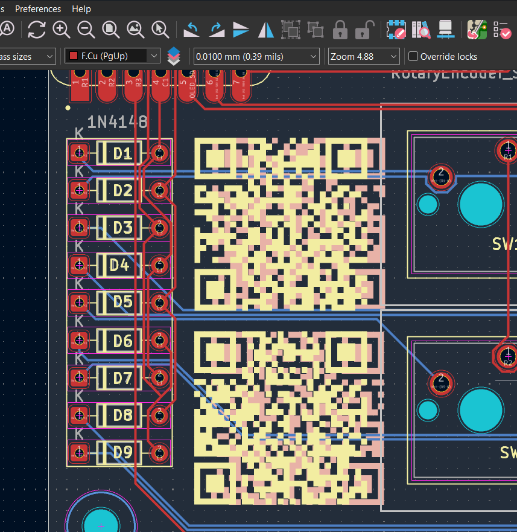
>
>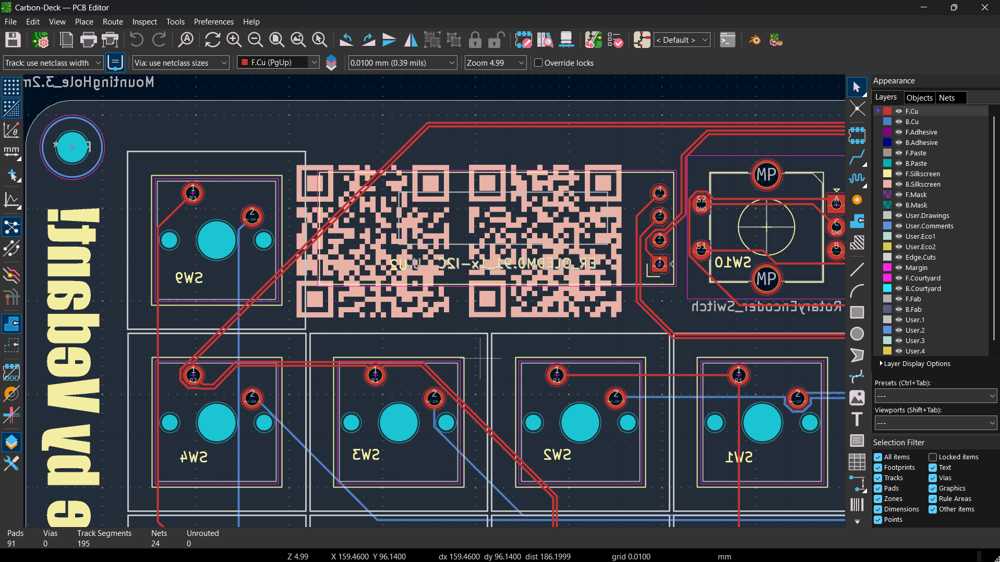
>

>**20 November 2026**  
>**Journal 4**  
>**~1 hrs 40 mins**
>- Searched for some years to eventually find the correct 3d model of the OLED display. This took a long time, but once I found it on GrabCAD, I almost found the 3d models of other components like a diode, Xiao RP2040, Cherry MX Red switches (not low profile), EC11 rotary encoder, etc in 20 mins.
>- Once found, I installed them as .step files and placed them manually in the 3d model section of the components in the PCB.
>- Annnnd then what! Just pressed Alt+3 to take an initial glimpse of the PCB.
>- Felt like my PCB was almost done.
>
>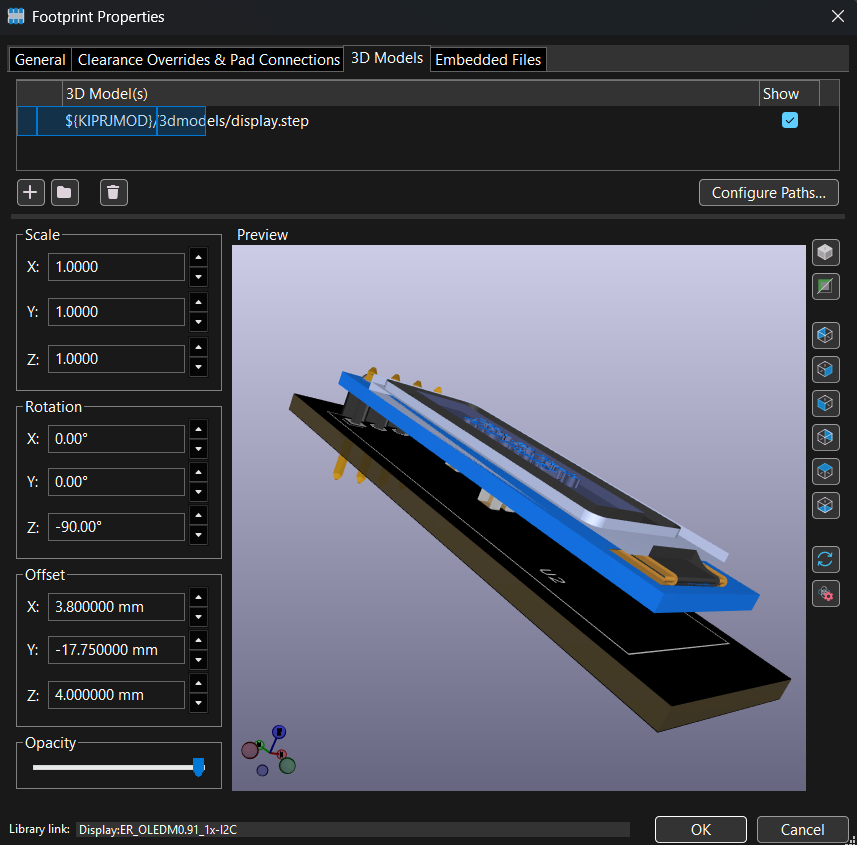
>
>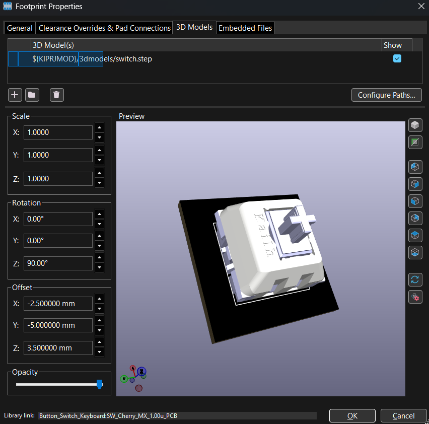
>
>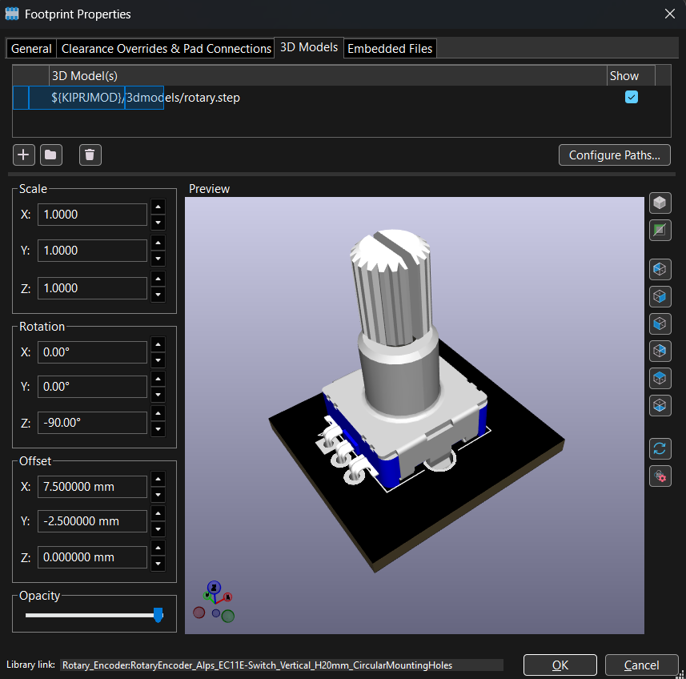
>
>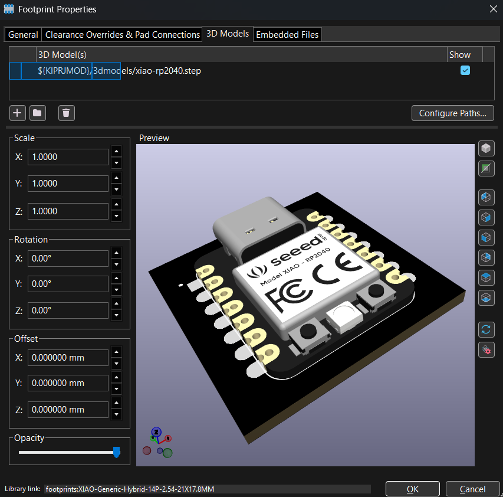
>
>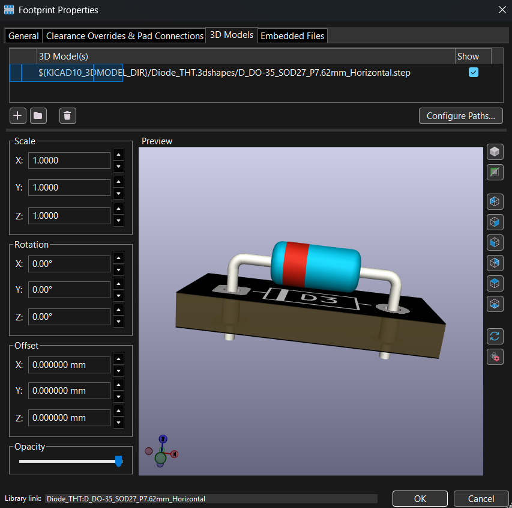
>
>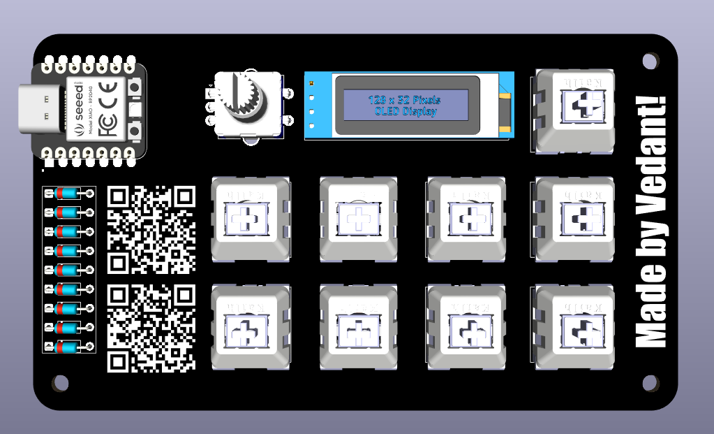
>

>**21 November 2026**  
>**Journal 5**  
**~2 hrs 25 mins**
>- Tried using two new extensions this time.
>- Installed [FABRICATION TOOLKIT by bennymeg](https://github.com/bennymeg/Fabrication-Toolkit) as a .zip file.
>- Installed [PCB2BLENDER by 30350n](https://github.com/30350n/pcb2blender) as a .zip file.
>- Later, I installed them as a file in the KiCAD plugin and content manager.
>- Exported the files for fabrication using the Fabrication toolkit, and it was very good.
>- Exported the .pcb3d file using pcb2blender so as to import it into Blender and get some cool renders.
>- Installed blender 4.5lts tried to get some render images using the .pcb3d file but I was very new to blender and my laptop's GPU didn't supported the thought of getting some renders. Eventually, I had to drop it.
>- Luckily, I found a friend who provided me with the rendered images. Great, thanks to her!
>- Ultimately, I used two new plugins and found them great.
>
>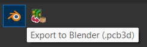
>
>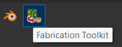
>
>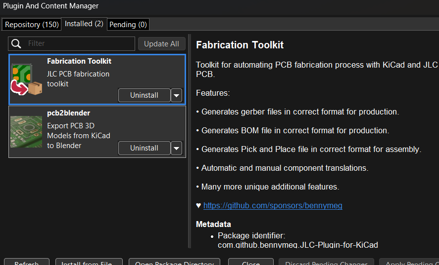
>

>**21 November 2026**  
>**Journal 6**  
>**~2 hrs 51 mins**  
>Planned and structured the code. Later, wrote the main.py firmware for the microcontroller. It has some cool switch functions as briefed below. You can modify the file main.py for your own key functions. The OLED display is coded to show the last pressed key's function. The rotary encoder increases and reduces volume and has a push button for mute/unmute.
>
>1] Layer 0 - Normal Mode
>
>| Switch | Function |
>|---|---|
>| Switch 1 | Brightness Up |
>| Switch 2 | Windows |
>| Switch 3 | W |
>| Switch 4 | Mute |
>| Switch 5 | Brightness Down |
>| Switch 6 | A |
>| Switch 7 | S |
>| Switch 8 | D |
>| Switch 9 | Ctrl (Layer Modifier) |
>
>2] Layer 1 - Ctrl Mode
>
>| Switch | Function |
>|---|---|
>| Switch 1 | Ctrl + Z (Undo) |
>| Switch 2 | Ctrl + Y (Redo) |
>| Switch 3 | Ctrl + C (Copy) |
>| Switch 4 | Ctrl + V (Paste) |
>| Switch 5 | Win + Tab |
>| Switch 6 | Ctrl + X (Cut) |
>| Switch 7 | Ctrl + A (Select All) |
>| Switch 8 | Ctrl + S (Save) |
>| Switch 9 | (Inherits Layer 0) |
>
>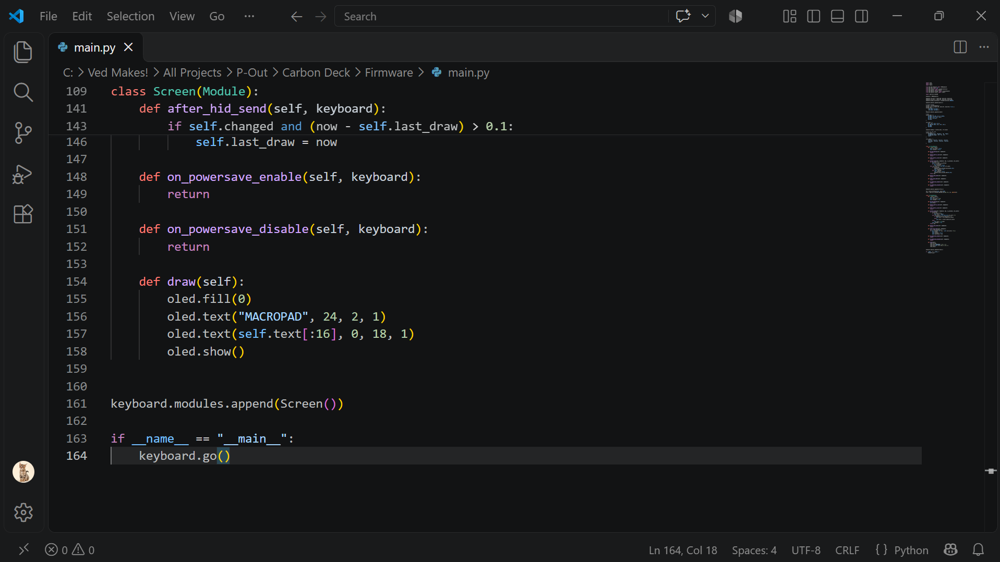
>

>**21 November 2026**  
>**Journal 7**  
>**~4 hrs 49 mins**  
> Started making an enclosure for the keypad. Worked a lot until I was about to finish; I realised that the enclosure is a huge gamble due to the misfit of its size with Cherry MX switches and the rotary encoder, causing a great flaw of non-matching height for the upper case of the enclosure. So I had to redesign the case but it was very difficult to make one with the given design of my PCB so I decided to go with the epoxy resin method and looking to that it would result into an awesome transparent body I decided to go with it. Hence, I designed a mold for the resin body of the keypad by importing the .step file of the PCB and matching the exact dimensions. Though I still have to be careful while making it with epoxy resin.
>
>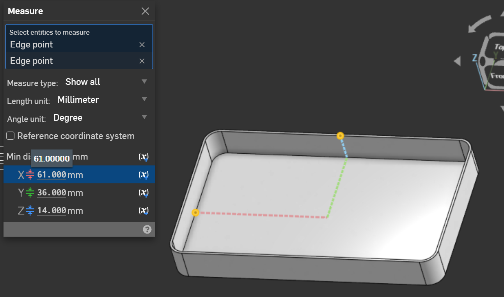
>

>**22 November 2026**  
>**Journal 8**  
>**~3 hrs**  
> I made a repository for this project. Made organised directories like Assets/, Hardware/, CAD/, PCB/, Fabrication/, and Firmware/. Once done, I added all the source files and images via Code and pushed them to the repository. Made files like License, main.py, etc. Made a BOM.csv for the project so as to help the makers and readers (Took a bit long to find the correct switch and Keycaps + a bunch of other items) after getting quotes from JLCPCB and Robu. Wrote and refined a detailed README.md. Made a JOURNAL.md to track progress, though it does not include everything while I made this project. And that's it! I guess I have done good work. Feels like my most organised repository until now. Cyaa, thanks for reading :)
>
>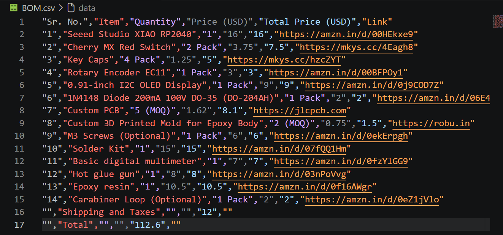
>
>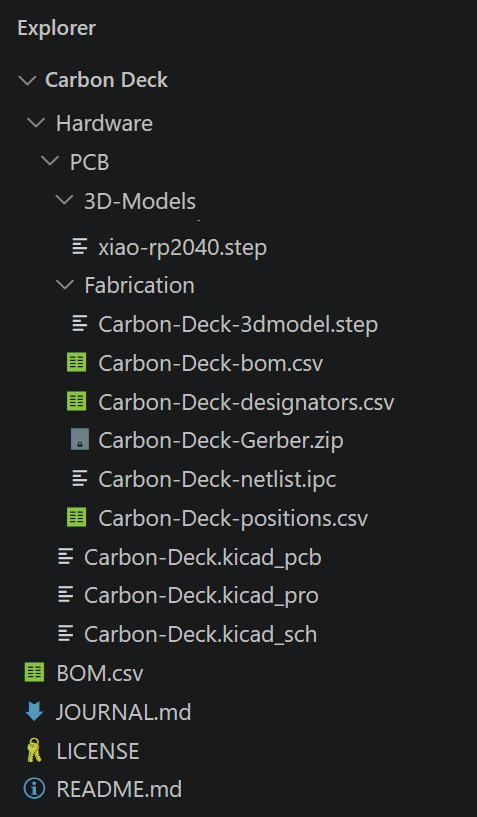
>
>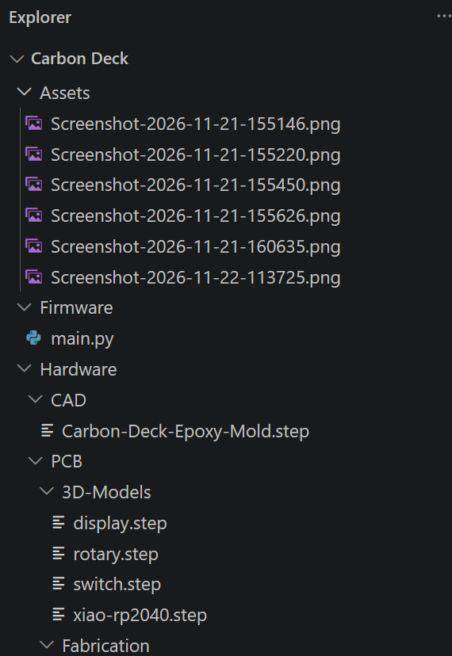
>
>
>

>**Summary:** 
>Worked about 21-24 hrs. Completed the design in two days overall. Loved the process. Outcomes: polished keypad.
