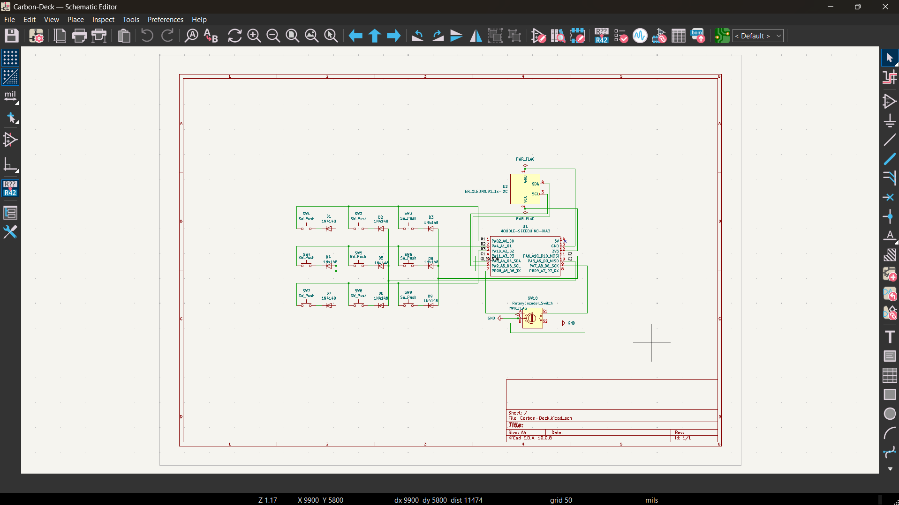
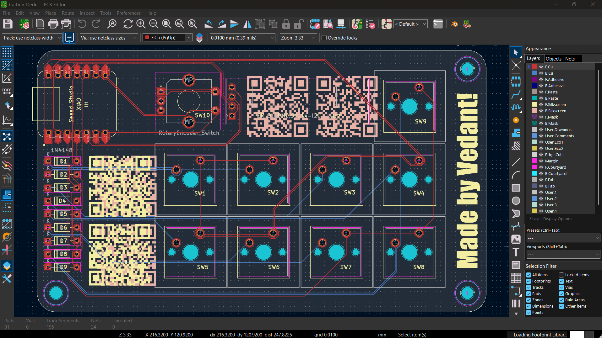
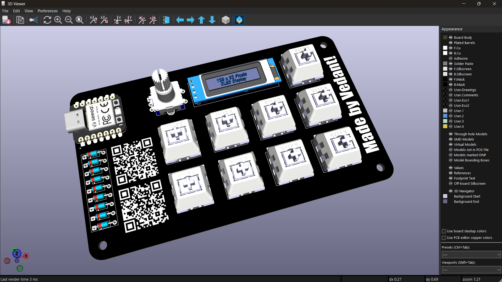
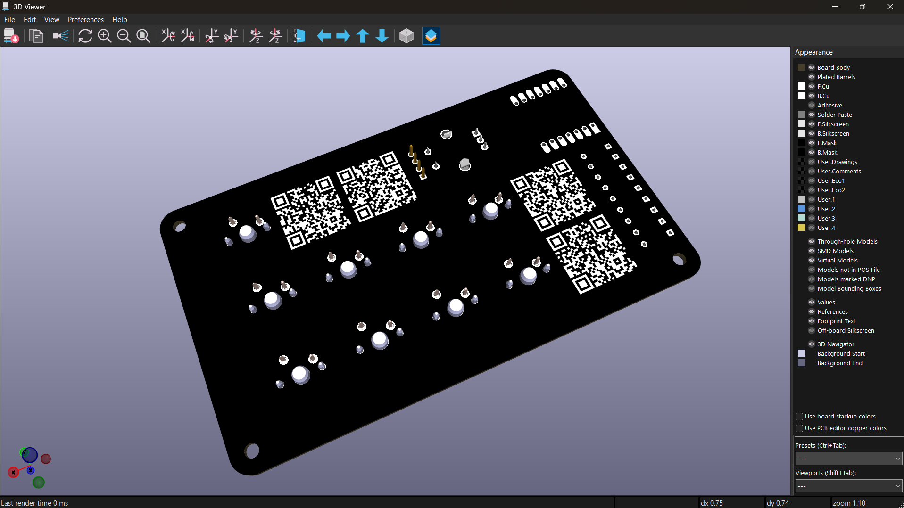
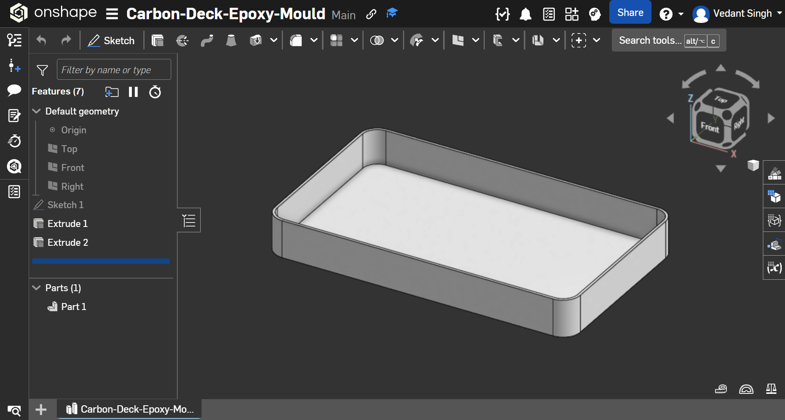
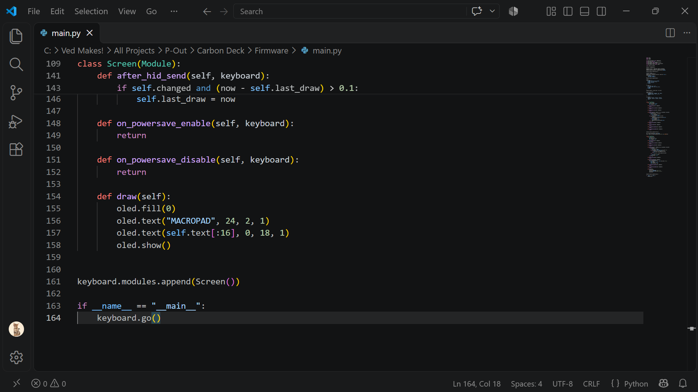
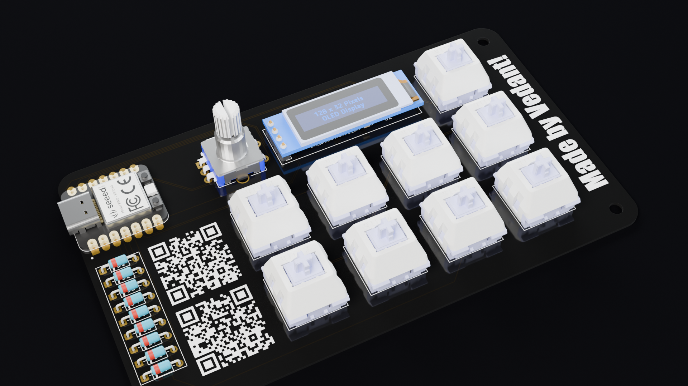

# carbon-deck
Carbon Deck is a custom keypad with nine keys.

## About
Carbon Deck is a custom keypad with 9 keys featuring Cherry MX Red switches, white translucent keycaps, a rotary encoder, an OLED display, a custom-designed PCB, and an epoxy resin transparent body made using a mold. The purpose of making this is to have quick access to some key combinations and separate W-A-S-D key controls, as reflected in the [firmware](Firmware/main.py). Carbon Deck is made from scratch using KiCAD, Onshape, and VS Code.

## Project Glimpse
1. PCB schematic in KiCAD

   
   <br><br>

2. PCB layout in KiCAD

   
   <br><br>

3. 3D view of PCB in KiCAD (Front)

   
   <br><br>

4. 3D view of PCB in KiCAD (Back)

   
   <br><br>

5. Epoxy resin mold in Onshape

   
   <br><br>

6. main.py in Code

   
   <br><br>

7. Rendered image of the PCB

   
   <br><br>

## Repository Structure
```text
carbon-deck/
├── Assets/
├── Firmware/
├── Hardware/
│   ├── CAD/
│   └── PCB/
│       ├── 3D-Models/
│       ├── Fabrication/
│       ├── Carbon-Deck.kicad_pcb
│       ├── Carbon-Deck.kicad_pro
│       └── Carbon-Deck.kicad_sch
├── BOM.csv
├── JOURNAL.md
├── LICENSE
└── README.md
```
- Hope it helps with navigating through!
- To view the epoxy mold (CAD .step) in Onshape, click [here!](https://cad.onshape.com/documents/1ebd2b1856aa9139ec1d090f/w/29e16372d1afa4f1339b2643/e/67207562f69c83acb4aecd62)

## How to get your own keypad?
1. Download the [.step](Hardware/CAD/Carbon-Deck-Epoxy-Mold.step) file from the repository.
2. Go to your 3D printing service website and get a print with the specs mentioned below.
3. Download the KiCAD PCB project files i.e. [.kicad_sch](Hardware/PCB/Carbon-Deck.kicad_sch), [.kicad_pcb](Hardware/PCB/Carbon-Deck.kicad_pcb) and [.kicad_pro](Hardware/PCB/Carbon-Deck.kicad_pro)
4. Import these files into KiCAD and edit them as you want!
5. Export the fabrication files required by your fabrication service. This may include gerber.zip, pick_and_place.csv, bom.csv, etc. Make sure there are no DRC errors while exporting.
6. Upload the gerber.zip as well as the fabrication files to your fabricator's service and use the specifications mentioned below. Fabricator recommended: [JLCPCB](https://jlcpcb.com). You can either get the PCB and components to hand-solder them yourself or get a pre-assembled PCBA!
7. Order the components and other required materials mentioned in [bill of materials](BOM.csv).
8. After you get your components, solder them on your PCB!
9. Use a multimeter to check the functioning of the components.
10. Download and flash the microcontroller with the [firmware](Firmware/main.py) in the repository. Or with your edited version of it!
11. Get your 3d printed mold.
12. Put some M3 screws in the mounting holes of the PCB so that it stands well in the mold. If you don't have M3 screws, you may use any supports to make it stand at the correct height.
13. Mix your epoxy resin and hardener in the given ratio.
14. After mixing well, pour it into the mold. (Do place your carabiner loop if you are using one)

CAUTION:
- Before pouring in the mix, make sure all of your components work properly. After soldering them on the board.
- Do not pour too much of the mix in the mold so that it compromises the ability or totally disables the functionality of the key switches. (Cherry MX switches have springs which may get stuck due to hardening of epoxy)
- Make sure that the Type-C female port of the microcontroller doesn't get filled with epoxy, resulting in damage to it.
- Overall, you have to be careful with every component; while epoxy resin transparent body looks awesome, it has risks of damaging the components if not handled carefully. Skip the epoxy method if you are unsure of your capabilities in making it work, and try making an enclosure for it.

15. Wait and give enough time for the epoxy to cure. Break and peel off the mold once it cures.
16. Hurray! You have a working, awesome, transparent keypad.

## Fabrication Specs
1. 3D Print:
    - Printer: 0.2 mm Standard Quality
    - Material: PLA
    - Color: Any
    - Infill: 30%

2. PCB:
    - Layers: 2 Layers
    - Base material: FR4
    - Board Thickness: 1.2 mm (1.6 mm for more rigidity)
    - Solder Mask: Choose whatever color you like
    - Silkscreen: Choose whatever color you like (Choose something that contrasts well with the solder mask color)
    - Finish: HASL (With lead)
    - Via Covering: Untented or Tented

## [BOM](BOM.csv) as a table
| Sr. No. | Item                                     | Quantity | Price (USD) | Total Price (USD) | Link                       |
|---------|------------------------------------------|----------|-------------|-------------------|----------------------------|
| 1       | Seeed Studio XIAO RP2040                 | 1        | 16          | 16                | https://amzn.in/d/00HEkxe9 |
| 2       | Cherry MX Red Switch                     | 2 Pack   | 3.75        | 7.5               | https://mkys.cc/4Eagh8     |
| 3       | Key Caps                                 | 4 Pack   | 1.25        | 5                 | https://mkys.cc/hzcZYT     |
| 4       | Rotary Encoder EC11                      | 1 Pack   | 3           | 3                 | https://amzn.in/d/00BFPOy1 |
| 5       | 0.91-inch I2C OLED Display               | 1 Pack   | 9           | 9                 | https://amzn.in/d/0j9COD7Z |
| 6       | 1N4148 Diode 200mA 100V DO-35 (DO-204AH) | 1 Pack   | 2           | 2                 | https://amzn.in/d/06E40KEc |
| 7       | Custom PCB                               | 5 (MOQ)  | 1.62        | 8.1               | https://jlcpcb.com         |
| 8       | Custom 3D Printed Mold for Epoxy Body    | 2 (MOQ)  | 0.75        | 1.5               | https://robu.in            |
| 9       | M3 Screws (Optional)                     | 1 Pack   | 6           | 6                 | https://amzn.in/d/0ekErpgh |
| 10      | Solder Kit                               | 1        | 15          | 15                | https://amzn.in/d/07fQQ1Hm |
| 11      | Basic digital multimeter                 | 1        | 7           | 7                 | https://amzn.in/d/0fzYlGG9 |
| 12      | Hot glue gun                             | 1        | 8           | 8                 | https://amzn.in/d/03nPoVvg |
| 13      | Epoxy resin                              | 1        | 10.5        | 10.5              | https://amzn.in/d/0f16AWgr |
| 14      | Carabiner Loop (Optional)                | 1 Pack   | 2           | 2                 | https://amzn.in/d/0eZ1jVlo |
|         | Shipping and Taxes                       |          |             | 12                |                            |
|         | Total                                    |          |             | 112.6             |                            |

## License
[MIT](LICENSE)- Use, modify, share as you like!

## Notes
- If ya'll like this project, make sure to see my other projects [Laptop Stand](https://github.com/vd-sh/laptop-stand), [Tab Mount](https://github.com/vd-sh/tab-mount), or [Book Stand](https://github.com/vd-sh/book-stand)
- Or simply visit my [profile](https://github.com/vd-sh) to see the latest projects :)
